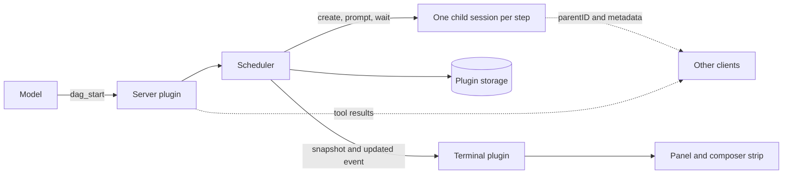

# opencode-questline

Agent DAGs for [OpenCode V2](https://opencode.ai/v2/docs/). The model hands
OpenCode a dependency graph of sub-agent steps. Independent steps run in
parallel, each in its own child session, and a live panel in the terminal UI
shows the graph while it runs.

Developed against OpenCode 2.0.29 and its plugin API.

## Table of Contents

- [What it adds](#what-it-adds)
- [Install](#install)
- [Running a DAG](#running-a-dag)
- [The panel](#the-panel)
- [How it works](#how-it-works)
- [Other clients](#other-clients)
- [Permissions and cost](#permissions-and-cost)
- [Limits and unverified behavior](#limits-and-unverified-behavior)
- [Development](#development)
- [License](#license)

## What it adds

| Piece | What it does |
| --- | --- |
| `dag_start` | Starts a run from a list of steps and waits for it by default |
| `dag_status` | Shows a run as a table; defaults to the newest run in the session |
| `dag_cancel` | Interrupts the running steps and cancels the run |
| `dag_retry` | Re-runs failed, skipped, and cancelled steps; finished steps keep their output |
| Panel | A graph of the run beside the transcript, shown only in the session that owns a running DAG |
| Composer strip | One line above the prompt while a run is going |

## Install

The package is not published yet. Load it from a checkout by absolute path in
`~/.config/opencode/opencode.jsonc`:

```jsonc
{
  "plugins": ["/absolute/path/to/opencode-questline"]
}
```

OpenCode needs the peer packages next to the plugin, so install them in the
checkout first:

```sh
npm install
```

Restart OpenCode after changing the plugin. Terminal clients load the `./tui`
export; other clients load only the server half.

## Running a DAG

Ask for one explicitly. The tool description tells the model not to start a DAG
for ordinary planning or coding.

```text
Run a DAG: read the three config files in parallel, then write one summary
that depends on all three.
```

The model calls `dag_start` with steps like these:

```json
{
  "name": "config-review",
  "maxParallel": 3,
  "nodes": [
    { "id": "app", "prompt": "Summarize app.yaml" },
    { "id": "db", "prompt": "Summarize db.yaml" },
    { "id": "net", "prompt": "Summarize net.yaml" },
    { "id": "report", "prompt": "Write one report", "depends_on": ["app", "db", "net"] }
  ]
}
```

| Rule | Value |
| --- | --- |
| Steps per run | 1 to 24 |
| Step id | Lowercase letters, digits, `-` and `_`; up to 32 characters; unique |
| `maxParallel` | 1 to 8, default 3 |
| Step fields | `id`, `prompt`, `agent`, `model`, `timeout`, `maxCost`, `maxTokens`, `label`, `depends_on`; unknown keys are rejected |
| `model` | `provider/modelID`, optionally `#variant`. When omitted the host picks its own default for new sessions, which is not necessarily the parent session's model. Set it on every step |
| `timeout` | 1 to 3600 seconds. The step is failed and its child session interrupted when it expires |
| `maxTokens` | Ceiling on total tokens (input, cached input, output, reasoning), checked every 2 seconds while the step runs and again when it ends. Each child starts with about 23,000 tokens of instructions and tool definitions, which a warm child reports as cached input, so set it well above that |
| `maxCost` | USD ceiling, checked the same way. Free or unpriced models report a cost of 0, so this never trips for them; use `maxTokens` |
| `retries` | Automatic retries after a failure or timeout, 0 to 3, default 0, so a step gets at most `retries + 1` attempts. A step that exceeds its token or cost cap is never retried. A run also stops retrying after 6 retries in total, whatever its steps ask for. The status table shows `(attempt N)` for a retried step |
| Dependency output | Each step receives its dependencies' outputs, about 4,000 characters each |
| Runs per session | At most 3 running at once; the newest 10 are kept |
| Nesting | `dag_start` is refused from inside a DAG step |

A failed step skips everything downstream of it. Independent branches keep
going. After a server restart, a run that was running comes back as `failed`
with the error `interrupted by restart`, and `dag_retry` continues it.

## The panel

| Situation | Behavior |
| --- | --- |
| A run starts in the session you are viewing | The panel opens, unless you dismissed it or the terminal is 80 columns or narrower |
| The run finishes and you never touched the panel | The panel closes after about 8 seconds |
| `<leader>d`, `/dag`, or the palette command | Toggles the panel and shows the newest run, running or not |
| A session with no run | A toast says so |
| You close the panel | It stays closed until a new run starts in that session |
| You are viewing a step's child session | The panel can be toggled there and highlights the step; it never opens on its own |

Keys while the panel has focus:

| Key | Action |
| --- | --- |
| `j` / `k`, arrows | Move the selection |
| `Enter` | Open the selected step's session |
| `c` | Cancel the run, after a confirmation |
| `r` | Retry a finished run |
| `q`, `Esc` | Close the panel |

Step glyphs: `○` pending, `●` running, `✓` completed, `×` failed, `·` skipped,
`−` cancelled. The strip reads `dag <name>  2● 3/6 ✓  1×  1m20s   <leader>d graph`.

## How it works



The server plugin owns the state. The terminal plugin only draws it: it asks
for a snapshot when it starts, when you switch sessions, and when the server
reconnects, then applies `updated` events by revision. RPC events are live only
and are not replayed, so a snapshot is always the recovery path.

`rpc.ts` is the contract between the two halves.

## Other clients

Every step is a real child session with `parentID` set to the origin session and
its own `metadata.dag = { runId, nodeId }`. The origin session gets a small
summary under `metadata.dag`. `dag_status` returns a markdown table. A client
that lists child sessions or renders tool results can show a run without the
terminal plugin. This has not been tested in any client other than the terminal
UI.

## Permissions and cost

The plugin does not change permission rules. The `dag_*` tools follow your
host's default for plugin tools, and child sessions run under the permission
rules in effect when they are created.

| Risk | Detail |
| --- | --- |
| Concurrency | Up to 24 child sessions at once: 3 runs times 8 parallel steps |
| Blocked calls | With `wait` true, a child waiting on a permission prompt holds the parent call until someone answers in the child session; the panel shows `waiting on permission` |
| Stored text | Plugin storage keeps prompts and outputs, capped at 4,000 characters each |
| Cross-session | A session can cancel or retry another session's run by id |

## Limits and unverified behavior

Everything here is covered by unit tests and a simulated host. Nobody has
driven a real terminal with it yet.

| Area | Status |
| --- | --- |
| Focus returning to the composer after the panel opens | Sends `pane.focus.left` once; unverified in a real terminal |
| `<leader>d` binding | Uses the host's string syntax; unverified |
| Panel width and fullscreen fallback | Uses terminal width over 80; unverified under tmux and Ghostty |
| Real model-driven runs | Not run; the scheduler is tested against a fake host |
| `session.wait` timing against `outcome` | Checked in types and source only |
| Concurrent metadata writers | The origin summary is a read-merge-write and can lose an update |
| Auto-open | Replaces any other plugin's panel in that session; the API cannot detect one |
| Strip in a child session | Also shown there |

## Development

```sh
npm install
npm test
npm run typecheck
```

| File | Role |
| --- | --- |
| `index.ts` | Server plugin: scheduler, tools, storage, RPC |
| `dag.mjs` | Pure logic: validation, state transitions, prompts, status table |
| `rpc.ts` | RPC and run schema shared by both halves |
| `tui.tsx` | Terminal plugin: panel, strip, keys |
| `layout.mjs` | Pure rendering of the graph, strip, and detail card |
| `panel-state.mjs` | Pure decisions: when to open and close, selection, run store |
| `test/` | `node:test` suites |

Tests need `typescript` to load the server plugin. One test decodes every
emitted run against the real RPC schemas and needs `@opencode/plugin`
installed, so it is skipped without `npm install`.

## License

MIT. See `LICENSE`.
